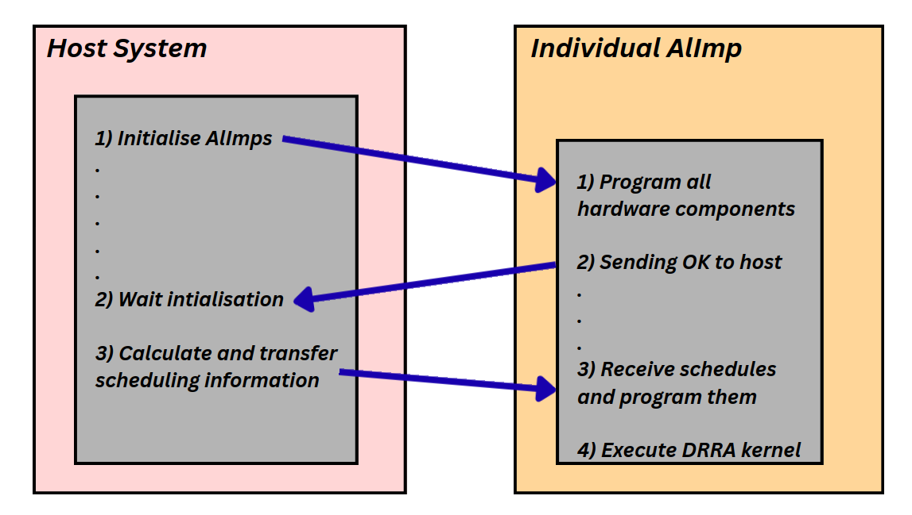
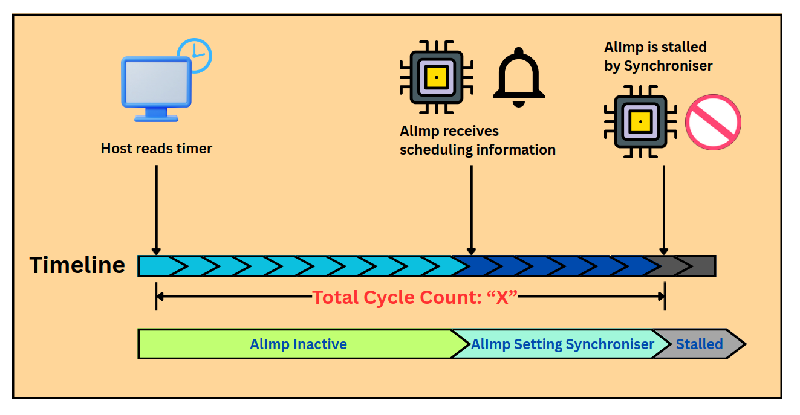

# Control Synthesis

## Main concept

Control Synthesis is the final Assembly stage. Its job is to turn the collection of
configured AlImps into a **functioning application**: it generates the processor
firmware at both the AlImp and host levels, instantiates and interconnects the RTL
components, and computes a **static global schedule** that makes every AlImp start
its computation at the correct cycle. The output is an RTL framework of the target
system — the interconnected AlImps, the host system, and the corresponding
processor programs.

The stage has two parts, AlImp-level control and application-level control, tied
together by a main control flow.

## Main control flow

Both the host and the AlImps boot from empty memories, so program code is first
loaded from an external source:

1. A start-up module initialises the host processor and loads its program.
2. The host wakes each AlImp by transferring its program code and releasing its
   reset; each AlImp performs local initialisation and then sends a mailbox
   notification back to the host.
3. The host computes and distributes scheduling information to all AlImps. Using
   it, each AlImp activates at its designated cycle and runs its DRRA kernel.


*Host and AlImp cooperate over the mailbox: initialise → notify → receive and program schedules → execute the DRRA kernel.*

## AlImp-level control

Most AlImp hardware is common, but the processor memory size, the DRRA fabric and
the communication modules vary per AlImp. This step provides the configuration
needed to instantiate the parameterised RTL, and focuses on two things:

- **AlImp firmware.** The firmware first programs the DRRA architecture
  (`drra_inst_loader()`) and loads the TLB and transporter programs generated by
  previous stages; it supports arbitrary numbers of TLBs/transporters and varying
  program sizes. After initialisation it notifies the host through the mailbox and
  waits for the schedule. The received timing values are programmed into the
  synchroniser, which activates the AlImp processor and the transporters at their
  scheduled cycles. The compute `kernel()` itself is generated by Vesyla; the rest
  of the firmware is generated by Sylva, and the two are merged into one program.
- **Local synchronisation.** Within an AlImp, only transporters need explicit
  synchronisation; their activation times are expressed relative to the AlImp
  processor's start time. For each transporter, the local activation time is
  derived from its absolute start time obtained in
  [Transporter Code Generation](ASM-Transporter.md), adjusted for fixed hardware
  delays and for the transporter's column position (the start signal is pipelined
  through intermediate hardware stages):

  $$T_{\text{tmp}} = \text{fire\_time}_{tp} - 4 - \text{col}, \qquad
    T_{tp} = T_{\text{tmp}} - \text{fire\_time}_{\text{AlImp}}$$

  These local timing values are later combined into the global schedule.

## Application-level control

This part generates the host firmware, formulates the timing model and determines
the static schedule for the whole AlImp network.

- **Host firmware.** The host initialises all AlImps, waits for their completion
  messages, and runs the scheduler. Program initialisation is application
  independent: all programs are stored in one flattened constant array, with
  separate offset and size tables used to reconstruct each program section
  (instruction `text` and `data`).
- **Timing model.** The scheduler reads the 64-bit global timer, computes a
  reference start time per AlImp, writes the per-AlImp start time and the
  transporter offsets to the mailbox, and notifies the AlImp. The AlImp programs
  these into its synchroniser and performs a blocking read whose release cycle is
  the AlImp's start time. The crucial unknown is therefore the per-AlImp
  `schedule_time`.

  
  *Timeline from the host reading the global timer, through the AlImp receiving and programming its schedule, to the stall that holds it until its start cycle.*

  ```c
  void scheduler(void) {
      uint64_t cur_time = read_timer64();
      for (uint32_t i = 0; i < NUMBER_OF_ALIMPS; i++) {
          uint64_t ref_time = cur_time + schedule_time[i];
          add_start_time(i, ref_time);
          add_transporter_times(i);
          notify_mailbox(i, STATUS_START_TIME);
      }
  }
  ```

- **Global synchronisation.** Because the host programs AlImps sequentially in a
  loop, each AlImp becomes ready at a slightly different time. Sylva computes a
  *ready time* per AlImp, corrects it for any negative transporter offsets, and
  takes the worst case to find the earliest globally consistent reference time:

  $$T_{\text{ready},i} = T_{\text{stall},i} - T_{\text{host}}$$
  $$T_{\text{new\_ready},i} = T_{\text{ready},i} - \min\!\big(\min(\text{relative\_times}_i),\,0\big)$$
  $$T_{\text{global\_ready}} = \max_i\big(T_{\text{new\_ready},i} - T_{\text{firetime},i}\big)$$
  $$\texttt{schedule\_time}[i] = T_{\text{global\_ready}} + T_{\text{firetime},i} - T_{\text{host}}$$

  In practice these timing values ($T_{\text{host}}$, the per-AlImp stall cycles)
  are collected through RTL simulation: a temporary firmware with deliberately
  large `schedule_time` values is generated to make the stalls observable, the
  testbench records the relevant cycles, the final schedule is derived from the
  equations above, and the firmware is regenerated and verified with the corrected
  schedule.

## Result

The result is a complete, simulatable RTL system: instantiated and interconnected
AlImps, the host, the firmware for both processor levels, and a static schedule
under which all AlImps execute correctly. See the
[Hardware Architecture](Architecture.md) page for the components being controlled.
