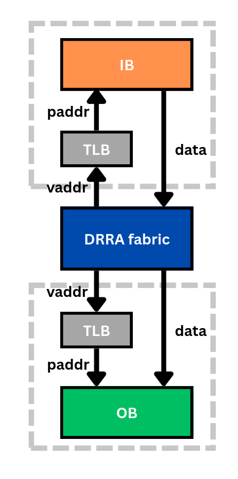

# TLB Code Generation

## Main concept

The DRRA fabric accesses application data using *virtual* addresses, while a
communication buffer stores that data in a compact *physical* address space. The
TLB Code Generation step produces the program that performs this virtual→physical
translation for the [TLBs](Architecture.md#tlb-and-address-generation-unit-agu)
attached to the communication memories on the DRRA side of each buffer.


*The TLB translates the DRRA's virtual addresses (vaddr) into the buffer's physical addresses (paddr).*

TLB code is generated for every memory implementation **except FIFO**: a FIFO
delivers data in order, so no address translation is needed. This is one reason
FIFO buffers are preferred when the access pattern allows them.

Using the virtual and physical address mappings determined during
[Memory Synthesis](ASM-MemSyn.md), this step chooses an appropriate TLB
implementation and generates its program. Two implementations are supported.

## Conventional TLB

The conventional TLB stores an explicit virtual→physical map in a lookup table. It
supports arbitrary addressing patterns at the cost of one table entry per address,
so it can require a relatively large memory.

The table size is found by starting small and doubling until every mapping fits
without conflicts. The algorithm fills the table (indexing by `virtual % size`),
verifies that every virtual address reads back its expected physical address, and
— if any conflict is found — doubles the size and retries.

```rust
let mut tlb_size = 1;
loop {
    let mut tlb = vec![0; tlb_size];
    let mut fail = false;

    // place every mapping
    for i in 0..total_length {
        let v = virtual_addr[i];
        let p = physical_addr[i];
        tlb[v % tlb_size] = p;
    }

    // verify there were no conflicts
    for i in 0..total_length {
        let v = virtual_addr[i];
        if tlb[v % tlb_size] != physical_addr[i] {
            fail = true;
            break;
        }
    }

    if !fail { break; }
    tlb_size *= 2;
}
```

## Address Generation Unit (AGU)

The AGU implementation does not store individual mappings; instead it computes the
physical address directly with the affine, three-level nested-loop function

$$A_{\text{physical}} = A_{\text{base}} + (i_c\,S_i) + (j_c\,S_j) + (k_c\,S_k)$$

If Sylva can find values of $A_{\text{base}}$, the loop indices/bounds and the
strides $S_i, S_j, S_k$ that reproduce the required physical-address sequence, it
programs those parameters into the AGU. The synthesis flow derives these values
heuristically from the physical address pattern and then validates the generated
function against the required sequence.

Because the AGU needs far less hardware than a full lookup table, it is **preferred
whenever the pattern can be expressed with affine indexing and strides**. The
conventional TLB is used as the fallback for irregular patterns.

## Relationship to the hardware

The generated programs are loaded at run time by the AlImp firmware into the
[`tlb`](https://github.com/silagokth/sylva-components/tree/main/components/tlb)
components (`translate_buf` for the conventional TLB, `translate_agu` for the AGU)
through the peripheral interface. See the
[Hardware Architecture](Architecture.md) page for the surrounding hardware.
