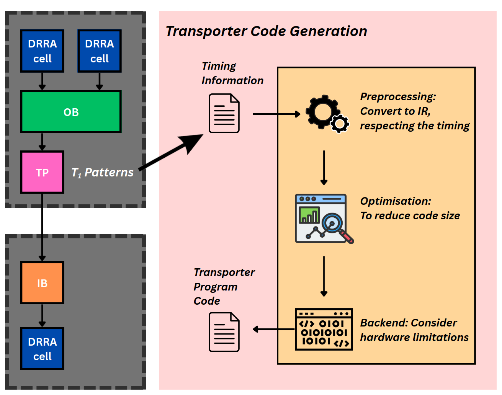

# Transporter Code Generation

## Main concept

Transporters are the active components that move data from an Output Buffer (OB) to
the next Input Buffer (IB). This step compiles, for every transporter, the program
that performs its scheduled data movements with **cycle-level accuracy**, using the
scheduling and addressing information produced by earlier stages.

In most cases each OB instantiates one transporter, although some memory
implementations (such as register files) may require two; code is generated
independently for every transporter. Because the transporter is a tightly
constrained processor — only 15 usable registers and a minimal
[instruction set](Architecture.md#transporter-isa) — this is essentially a small
**compiler** with three stages: preprocessing, optimisation, and a backend. They
all operate on an intermediate representation (IR).


*Timing information and the T₁ address patterns are converted to IR (preprocessing), optimised to reduce code size, and lowered to transporter program code (backend).*

## Intermediate Representation (IR)

Since the transporter compiler works under strict timing constraints, the IR makes
the clock cycle of every instruction explicit. Each IR entry is a *(time,
instruction)* pair, where the instruction is one of the transporter ISA operations:

```
time   instruction
0      NOP
1      LDI R3 16
2      MOV R3 R0 0
```

## Preprocessing

Preprocessing converts the scheduling information — a list of *(clock cycle, source
address, target address)* triples — into IR. Each transfer becomes one `MOV`
issued at its scheduled cycle, with the source and target addresses first loaded
into registers by `LDI` instructions. At this stage an *unlimited* number of
registers is assumed (no spilling yet), and the `LDI` instructions that prepare a
`MOV` are placed at negative time indices, to be scheduled into real cycles later.

```
input_list      ->  time   instruction
(5, (10, 20))       -4     LDI R4 20
(6, (11, 21))       -3     LDI R3 10
                    -2     LDI R2 21
                    -1     LDI R1 11
                     5     MOV R3 R4 0
                     6     MOV R1 R2 0
```

## Optimisation techniques

These reduce register usage and final code size:

1. **Removing redundant registers** — if several `LDI` instructions load the same
   value, keep one and redirect the others to it.
2. **Replacing consecutive `MOV` with `MOVC`** — if a run of `k` back-to-back
   `MOV`s shares a constant increment `c` (so source `R0 + n·c` and destination
   `R1 + n·c` for `n = 0…k−1`), it collapses to a single `MOVC R0 R1 R2 k` with
   `R2 = c`.
3. **Reducing register loads with immediate offsets** — the `MOV` immediate field
   lets the effective addresses be `src = R0 + IMM` and `dst = R1 + IMM`, removing
   some `LDI` instructions entirely.

## Compiler backend

The backend turns the optimised IR into executable transporter code:

1. **Removing unused registers** — drop `LDI`s whose register is never used.
2. **Tightening the timing in the IR** — move the `LDI` instructions (initially
   parked before time zero) into available positive time slots, respecting that an
   `LDI` must precede the first use of its register and cannot land on an occupied
   slot or inside a `MOVC`. Loads are scheduled most-used-register-first
   (dependency-driven load scheduling).
3. **Register allocation** — map the unlimited "virtual" registers onto the 15
   usable physical registers, using the classic pipeline of *liveness analysis →
   interference-graph construction → graph colouring*, spilling when colouring
   fails. The spill candidate is ranked by a heuristic:

   $$score = spillability + live\_range\_pressure + interference\_cost - reuse\_value$$

   ```rust
   loop {
       let lives  = liveness(&ir);
       let graph  = interference_graph(&ir, &lives);
       let colours = graph_colouring(&ir, &graph);
       if colours.success { break; }
       transforming_ir(&mut ir, colours.spilled_register);
   }
   ```

4. **Filling `NOP` instructions** — insert `NOP`s into every empty time slot so the
   real instructions execute on exactly their scheduled cycles, and append a
   final `NOP 0` so the transporter stalls after it finishes.
5. **Final check and code generation** — validate value bounds, report the
   transporter's start time, end time and execution latency back to Sylva (start
   times may be negative here and are resolved during
   [Control Synthesis](ASM-Control.md)), and emit the final binary following the
   ISA.

## Why it matters

Program size directly determines the transporter's instruction-memory area. For
regular, affine patterns (e.g. the Sobel example) the `MOV`→`MOVC` optimisation can
roughly halve the instruction count; for irregular patterns (e.g. most LeNet-5
edges) it rarely applies, and code size is dominated by per-transfer `LDI`
overhead.
