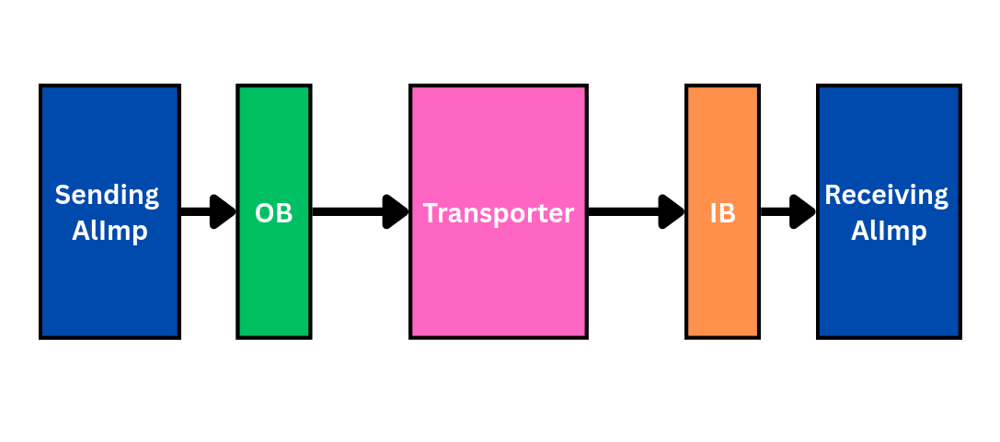
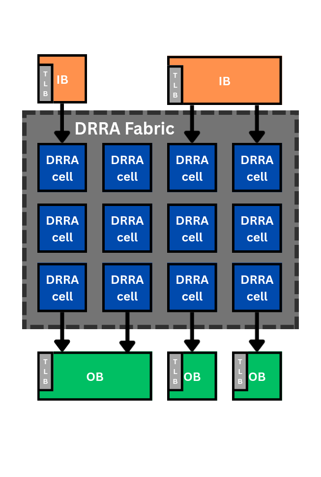
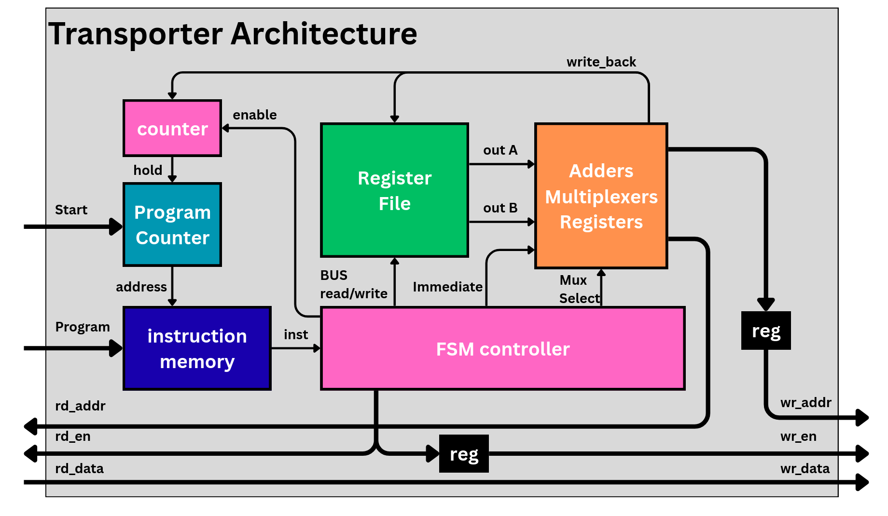
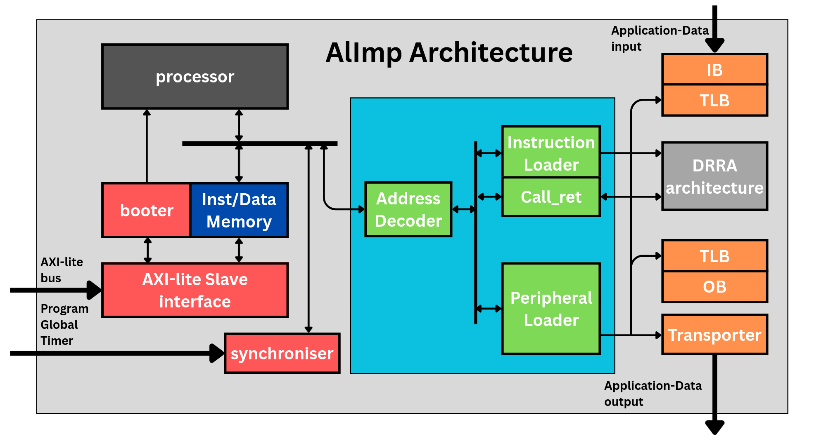
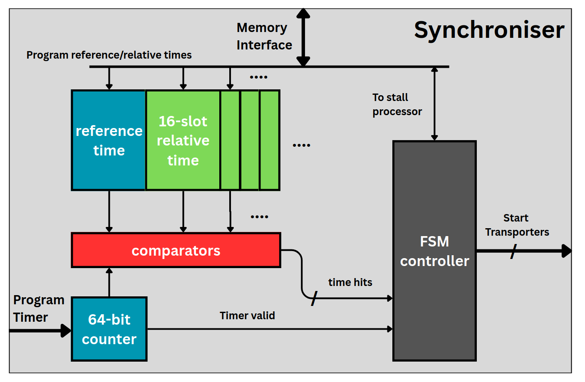
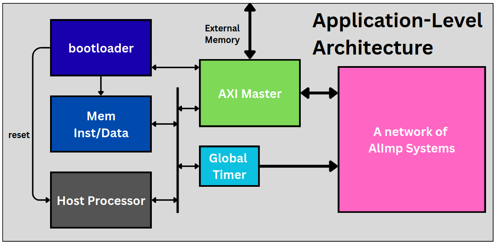

# Hardware Architecture

This page describes the hardware infrastructure that Sylva targets and generates.
The Sylva EDA tool does not synthesise logic from scratch — it composes a small set
of pre-characterised, layout-aware RTL blocks (the
[`sylva-components`](https://github.com/silagokth/sylva-components) library) into a
working system. Understanding these blocks makes the synthesis stages much easier
to follow, because each stage ultimately configures one of them.

The architecture has three layers:

1. **Communication components** — the buffers and transporter that move data
   between algorithm implementations.
2. **AlImp architecture** — a single Algorithm Implementation and the
   micro-architecture that controls it.
3. **Application-level architecture** — the network of AlImps and the host system
   that orchestrates them.

## Communication components

Sylva follows a *store-near/where-it-computes* principle: because data movement
dominates energy and latency, and because the HSDF model transfers data on each
edge only once per iteration, each edge gets its own localised communication path
rather than a shared memory. That path has three parts:

```
sending DRRA → OB → Transporter → IB → receiving DRRA
```


*The communication path between a sending and a receiving AlImp.*

- **Output Buffer (OB)** and **Input Buffer (IB)** are memories that temporarily
  hold application data until it is consumed. Separate buffers (rather than one
  shared memory) are used because AlImp cell sizes vary across the SiLago fabric.
- The **Transporter** is the active element — a specialised finite-state machine
  that issues read requests to an OB and transmits the data to the next AlImp's IB.
  It also gives placement freedom: by absorbing communication delay it lets the
  tool trade communication latency against layout congestion.

A buffer on the DRRA side also carries a **TLB** (Translation Lookaside Buffer) to
translate the DRRA's wide *virtual* address range into the smaller *physical*
address range of the buffer memory. The far side of a buffer does not need a TLB,
because it is driven either by a transporter (which already issues correct physical
addresses) or directly wired from a previous transporter.


*A TLB translates the DRRA's virtual addresses (vaddr) into the buffer's physical addresses (paddr); data flows directly.*

Because Vesyla arranges DRRA cells in a fixed rectangular block, the memory model
imposes two geometric limitations: a wide fabric would need many ports into a
single memory unit, and a memory unit cannot span an arbitrary number of columns.
Sylva therefore assumes each memory unit occupies at most one or two DRRA-cell
widths, and allows several memory units to be instantiated on one side.


*Multiple IB/OB units attached along the top and bottom of a DRRA fabric.*

### Memory unit

Buffers and processor/transporter memories are built from a configurable memory
unit with three types and three read-latency models:

| Memory type | Ports | Notes |
| --- | --- | --- |
| FIFO | 1 in, 1 out | Ordered; no address needed → no TLB required. |
| Register File (RF) | up to 2 read + 2 write | Addressed. |
| SRAM | 2 configurable read/write ports | Addressed; default for large memories. |

| Read latency | Behaviour |
| --- | --- |
| Zero-clock | Data returned immediately (used for conventional TLB lookups). |
| One-clock | Data after one cycle (used for IBs/OBs to maximise throughput). |
| Two-clock | Data after two cycles (processor & transporter memories; pipelines for a higher clock). |

### TLB and Address Generation Unit (AGU)

Two TLB implementations exist. The first is a **conventional TLB**: a register file
(zero-clock read) storing an explicit virtual→physical map, which supports arbitrary
patterns but costs one entry per address.

The second is an **Address Generation Unit (AGU)**, which computes the physical
address from an affine, three-level nested-loop function:

$$A_{\mathrm{physical}} = A_{\mathrm{base}} + (i_c\,S_i) + (j_c\,S_j) + (k_c\,S_k)$$

programmed with a base, three loop bounds $I,J,K$ and three strides $S_i,S_j,S_k$.
When the access pattern is affine — the common case for DRRA-generated patterns —
the AGU is far smaller than a full table and is preferred.

### Transporter ISA

The transporter is a simple, non-pipelined processor with a 16-entry, 16-bit
register file (R0 hardwired to 0 → 15 usable registers), a 32-bit instruction
memory and a few adders.


*Transporter datapath: program counter, instruction memory, register file, FSM controller and the read/write address paths.*

Its minimal instruction set is:

| Instruction | Opcode | Type | Function |
| --- | --- | --- | --- |
| `NOP`  | `0000` | 0R | Wait `IMMEDIATE` cycles; if `IMMEDIATE==0`, wait indefinitely. |
| `LDI`  | `0010` | 1R | Load `IMMEDIATE` into `R0`. |
| `MOV`  | `1000` | 2R | Move data from `OB[R1+IMMEDIATE]` to the next `IB[R0+IMMEDIATE]`. |
| `MOVC` | `1001` | 3R | Repeat `MOV` `IMMEDIATE` times with stride `R2` (continuous pattern). |

`NOP` cycles are how the compiler aligns each transfer to its exact scheduled
cycle. A program ends with `NOP 0`, which stalls the transporter until the next
start pulse. See the [transporter component README](https://github.com/silagokth/sylva-components/tree/main/components/transporter)
for the full encoding, and [Transporter Code Generation](ASM-Transporter.md) for
how programs are compiled.

## AlImp architecture

A single AlImp cannot form a complete application, so each one is wrapped in a
micro-architecture that runs its algorithm at the scheduled cycle and communicates
with the outside world. The main blocks are:

- **DRRA fabric** — the CGRA that executes the algorithm (generated by Vesyla).
- **Processor** — a PicoRV32 RISC-V core that manages control flow, initialisation
  and external communication, with an instruction/data memory.
- **Peripheral interface** — an *Address Decoder* plus the *Instruction Loader*
  (loads DRRA program code), *Call_ret* (issues the DRRA start signal and waits for
  completion), and the *Peripheral Loader* (configures TLBs and transporters).
- **AXI-Lite slave interface** — lets an external master (the host) read/write the
  AlImp; the AlImp's memories start empty and are filled over this bus.
- **Booter** — holds the AlImp CPU in reset until its program is loaded, then
  releases it.
- **Synchroniser** — the timing anchor that enables static, cycle-accurate
  execution.


*The AlImp micro-architecture: processor, memory, the cyan peripheral interface, the red external-communication blocks and the orange communication layers (IB/OB/TLB/transporter).*

### Synchroniser

Because the application follows a static schedule, the processor must issue control
signals — notably the DRRA start signal — at precise clock cycles. The synchroniser
holds a 64-bit timer (a local copy of the global time), a *reference time* and up
to 16 *relative transporter offsets*, plus comparators. The processor performs a
**blocking read** that stalls it until the global timer reaches the reference time;
at the matching cycles the synchroniser asserts the per-transporter start signals.
This same timing precision is what makes transporter operations deterministic.


*The synchroniser: a 64-bit counter, the reference-time and 16 relative-time slots, comparators, and the FSM that stalls the processor and fires the transporter starts.*

To keep the hardware configuration simple, an AlImp block exposes only two degrees
of freedom: the number of DRRA-cell rows (which sets its geometry) and the
processor memory size (which lets the tool allocate just enough instruction/data
memory to control logic area).

## Application-level architecture

At the top level, an application is a **network of AlImps** plus a **host system**
that orchestrates them. The host comprises:

- a **host processor** (PicoRV32) that initialises AlImps, manages communication
  and runs the scheduler;
- a **bootloader** that loads all program data from an external memory source (host
  program first, then the AlImp programs, then the TLB/transporter configurations)
  while holding the host CPU in reset;
- an **AXI-Lite master** that issues transactions to both the external memory and
  the AlImp network (the host is the master, AlImps are slaves);
- a **global timer**, a 64-bit counter reset to zero at start-up and broadcast to
  all AlImps over a dedicated timer bus, providing the common time reference for
  deterministic scheduling.


*The host (bootloader, instruction/data memory, AXI master and global timer) connected to a network of AlImp systems.*

## Hardware/software co-design

The interaction between firmware and hardware uses a **memory-mapped**
organisation: hardware modules are exposed through dedicated address ranges so
firmware can program them with ordinary loads and stores. The address space is
divided into host memories, a peripheral region, the AlImp region (address bits
`[27:18]` select one of up to ~1024 AlImps) and external memory.

### Multi-node communication (mailbox)

The host and each AlImp coordinate through a memory-mapped **mailbox** in the
AlImp's communication memory. Separate valid bits (`host_valid`, `cpu_valid`)
prevent race conditions, and the mailbox carries the 64-bit reference time
(`cpu_time_lo`/`cpu_time_hi`) and an array of relative transporter offsets
(`tp_time[i]`).

### Firmware

- **AlImp firmware** initialises the DRRA fabric, TLBs and transporters; notifies
  the host; receives its schedule and programs the synchroniser; performs the
  blocking read-to-start; runs the Vesyla-generated `kernel()`; and notifies
  completion.
- **Host firmware** programs all AlImps, waits for their initialisation, enables
  the global timer, runs the scheduler (computing each AlImp's reference time and
  transporter offsets), and waits for all AlImps to finish.

The reference times and offsets are obtained from the synthesis stages and, in
practice, calibrated through RTL simulation so that every AlImp starts at the
correct global cycle. See [Control Synthesis](ASM-Control.md) for how this schedule
is derived and how the firmware is generated.

## Where each stage configures the hardware

| Hardware element | Configured by |
| --- | --- |
| AlImp selection & geometry | [Binding](DSE-Bind.md), [Placement](DSE-Place.md) |
| Communication wires / NoC | [Routing](DSE-Route.md), [NoC Wire Synthesis](DSE-Noc.md), [Re-routing](ASM-Route.md), [NoC Resynthesis](ASM-ReNoc.md) |
| IB/OB sizes & channels | [GLIC Synthesis](DSE-Glic.md), [Memory Synthesis](ASM-MemSyn.md) |
| TLB / AGU programs | [TLB Code Generation](ASM-TLB.md) |
| Transporter programs | [Transporter Code Generation](ASM-Transporter.md) |
| Firmware & global schedule | [Control Synthesis](ASM-Control.md) |
